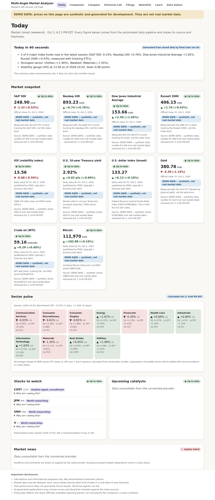
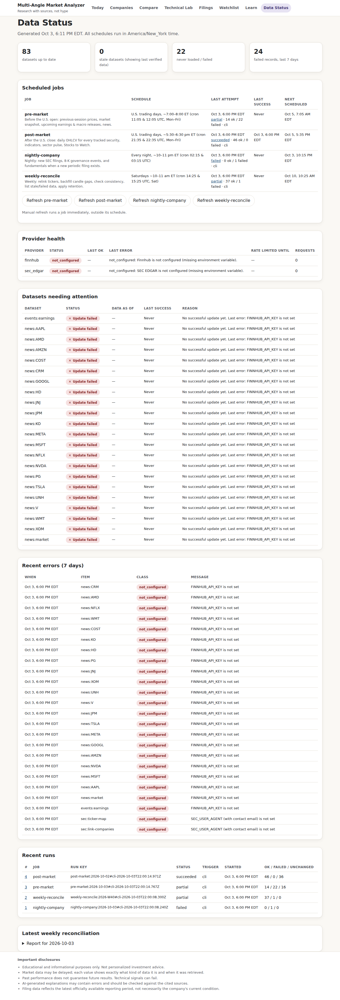

# Multi-Angle Market Technical Analyzer

Beginner-friendly equity research. Its foundation is an **automated daily data pipeline**: market prices, SEC filings, fundamentals, news and calendars are fetched on a schedule, validated, stored in PostgreSQL with full source and freshness tracking, and shown with honest labels. Nothing on the dashboard is hand-written daily content.

> Educational and informational purposes only. Not investment advice.

**Status: Phase 2 (data foundation) complete.** Phase 3 (core product pages) is next. See [Roadmap](#roadmap).

| Today (demo data) | Data Status (admin) |
|---|---|
|  |  |

## What works now

* **Scheduled jobs**: `pre-market`, `post-market`, `nightly-company` and `weekly-reconcile`. They run in America/New_York time with NYSE holidays, early closes and DST handled. Jobs are idempotent and lock-protected, each item fails independently, and they retry on the next slot.
* **Providers behind interfaces**: SEC EDGAR, Polygon.io/Massive, FRED, Finnhub, plus a clearly labelled demo provider. All share retries with backoff, `Retry-After`, rate limiting, timeouts, schema validation, error classes, health tracking and secret redaction.
* **Database**: Drizzle migrations, upserts on unique keys, transactions, source provenance, a freshness ledger, job runs, failures and provider health.
* **Deterministic calculations**: SMA, EMA, RSI, MACD and Bollinger Bands, recomputed only when candles change. SEC XBRL facts are normalized into annual and quarterly statements, then into financial-health metrics with stated formulas.
* **Today dashboard**, built entirely from the DB: 60-second summary (rule-based, no AI), Market Snapshot, Sector Pulse vs SPY, rules-based Stocks to Watch with "Why am I seeing this?", Upcoming Catalysts (confirmed / scheduled / estimated) and provider news.
* **Data Status admin page**: last attempted and successful run per job, next scheduled time, provider health, stale datasets, recent errors, run logs, the weekly reconciliation report, and manual refresh buttons.
* **60 automated tests** (calendar/DST/holidays, indicators, fundamentals, HTTP retry/rate-limit/redaction, SEC parsing, full pipeline on an in-memory Postgres).

## Quick start (local, no API keys)

```bash
npm install
cp .env.example .env.local            # optional
npm run seed:demo                     # runs every job with DEMO prices into ./.data/pglite
ADMIN_TOKEN=change-me-to-16+chars npm run dev
# open http://localhost:3000 and http://localhost:3000/status
```

Demo mode only synthesizes prices and macro series, and every value is stamped **DEMO DATA**. It never invents news, filings, events or company facts; those show "Data unavailable from the connected provider" until a real provider is configured.

## Real data: API setup

| Provider | Used for | Cost | Setup |
|---|---|---|---|
| SEC EDGAR | filings, 8-K governance items, XBRL financials, ticker→CIK | free | Set `SEC_USER_AGENT="Your App you@example.com"` (required by SEC fair-access policy) |
| [Polygon.io / Massive](https://polygon.io) | daily OHLCV for ETFs and stocks | free tier = end-of-day, 5 req/min | `POLYGON_API_KEY`; set `POLYGON_DATA_NATURE` to match your plan (`end_of_day`, `delayed_15m`, `real_time`) |
| [FRED](https://fred.stlouisfed.org/docs/api/api_key.html) | VIX, 10-yr yield, broad dollar index, WTI, Bitcoin; CPI/jobs/GDP/PPI release dates | free | `FRED_API_KEY` |
| [Finnhub](https://finnhub.io) | market & company news, earnings calendar | free tier | `FINNHUB_API_KEY` |
| Anthropic | AI explanations (Phase 4) | paid | `ANTHROPIC_API_KEY` (not used yet) |

Every variable is listed in [`.env.example`](.env.example). Keys are read only on the server and are redacted from logs and stored URLs.

## Daily scheduler (GitHub Actions)

`.github/workflows/scheduled-refresh.yml` is the scheduler:

| Job | UTC cron (two slots each, to cover EST and EDT) | ≈ ET |
|---|---|---|
| pre-market | `5 11 * * 1-5`, `5 12 * * 1-5` | 6–8 am |
| post-market | `35 21 * * 1-5`, `35 22 * * 1-5` | 4:35–6:35 pm |
| nightly-company | `15 2 * * *`, `15 3 * * *` | 9–11 pm |
| weekly-reconcile | `25 14 * * 6`, `25 15 * * 6` | Sat 9–11 am |

Every trigger runs `npm run job -- scheduled`. Each job checks its own ET window, trading-day status and run key, so only one slot does the work. The other slot either no-ops or retries a partial failure.

**Setup:**
1. Create a hosted Postgres database (e.g. Neon or Supabase free tier). Runners are ephemeral, so a hosted database is required.
2. In **Settings → Secrets and variables → Actions**, add these secrets: `DATABASE_URL`, `SEC_USER_AGENT`, `POLYGON_API_KEY`, `FRED_API_KEY`, `FINNHUB_API_KEY`. Optional variables: `TRACKED_TICKERS`, `POLYGON_DATA_NATURE`, `MARKET_EXTRA_CLOSURES`.
3. Under **Actions → Scheduled data refresh → Run workflow**, choose `all` with `force` checked to do the initial backfill (about 10 minutes on Polygon's free tier).
4. Check the run summary table and the `job-logs-*` artifact, or `/status` in the app.

Note: GitHub pauses scheduled workflows in repositories with no activity for 60 days. Re-enable the workflow from the Actions tab if that happens.

**Alternatives**: `GET/POST /api/cron/scheduled` with `Authorization: Bearer $CRON_SECRET` runs the same gated scheduler, for Vercel Cron or any external scheduler. A plain server can use crontab with `npm run job -- scheduled`.

## Deployment (web app)

Recommended: **Vercel + Neon**.
1. Import the repo in Vercel and set `DATABASE_URL`, `ADMIN_TOKEN`, `SESSION_SECRET` and the provider keys.
2. Migrations are applied by the scheduled workflow (`npm run db:migrate`). Alternatively, set `AUTO_MIGRATE=true` on the web app.
3. Optional: set `GITHUB_REPOSITORY` + `GITHUB_DISPATCH_TOKEN` (a fine-grained token with Actions: write). The admin refresh buttons then dispatch the workflow instead of running inside a time-limited serverless request.

Any Node 20+ host works: `npm run build && npm start`.

## Scripts

| Command | Purpose |
|---|---|
| `npm run dev` / `build` / `start` | Next.js |
| `npm run job -- scheduled` | What the scheduler runs |
| `npm run job -- <job> --force` | Run one job now (manual refresh) |
| `npm run job -- all --force --demo` | Seed with labelled demo prices |
| `npm run db:migrate` | Apply migrations |
| `npm run db:generate` | Create a migration after editing `src/lib/db/schema.ts` |
| `npm test` / `npm run typecheck` | Tests / types |

## Tests

`npm test` runs 60 tests with no network access. Pipeline tests use fake providers on an in-memory PostgreSQL (PGlite) and cover:
* successful refresh, idempotency, no duplicates
* partial failure and provider errors that keep existing data, labelled stale
* empty-response protection, lock contention and lease takeover
* new-filing detection and fundamentals refetch rules, 8-K governance events
* holidays, early closes and DST cron windows

Calculation tests use hand-computed fixtures.

## Known limitations

* **Index levels** are measured through tracking ETFs (SPY, QQQ, DIA, IWM, GLD), and the dollar index is the Fed broad index rather than DXY. Each card says so.
* **Polygon free tier** is end-of-day only, with roughly 2 years of history. `CANDLE_HISTORY_YEARS` asks for more, but the provider returns what the plan allows.
* **Earnings dates** from Finnhub are labelled "estimated" until results are reported, because the provider does not say whether a date is company-confirmed.
* **FOMC meetings, investor days and shareholder votes** are not yet in the catalyst calendar (no machine-readable source is wired yet).
* **Quarterly cash flow** is unavailable when issuers tag only year-to-date values. It is not derived by subtraction.
* **Banks and insurers** often use tags outside the mapping, so their metrics show as unavailable rather than wrong.
* **Sector Pulse** uses SPDR sector ETFs. Company-level GICS sectors are not yet assigned (SEC provides SIC codes only).
* The login rate limiter is per server instance (in memory).

## Roadmap

* **Phase 3:** company search and unified company page (overview, financial health UI with 3–5 year trends, governance from proxy filings, peers and moat evidence), Technical Lab (interactive candlesticks, W/M pattern detection, triple-verification filter), filing and document analyzer with prompt-injection-safe processing, user watchlists.
* **Phase 4:** grounded AI explanations (schema-validated, cached by input hash, cites stored sources only), the four-part plain-English explainer, and the Jargon Buster glossary.
* **Phase 5:** accessibility audit (axe), Playwright UX tests, performance budgets, dependency review.

See [`docs/ARCHITECTURE.md`](docs/ARCHITECTURE.md) for the audit, design, schema and integrity rules, and [`docs/sample-refresh-log.txt`](docs/sample-refresh-log.txt) for a real job log.
